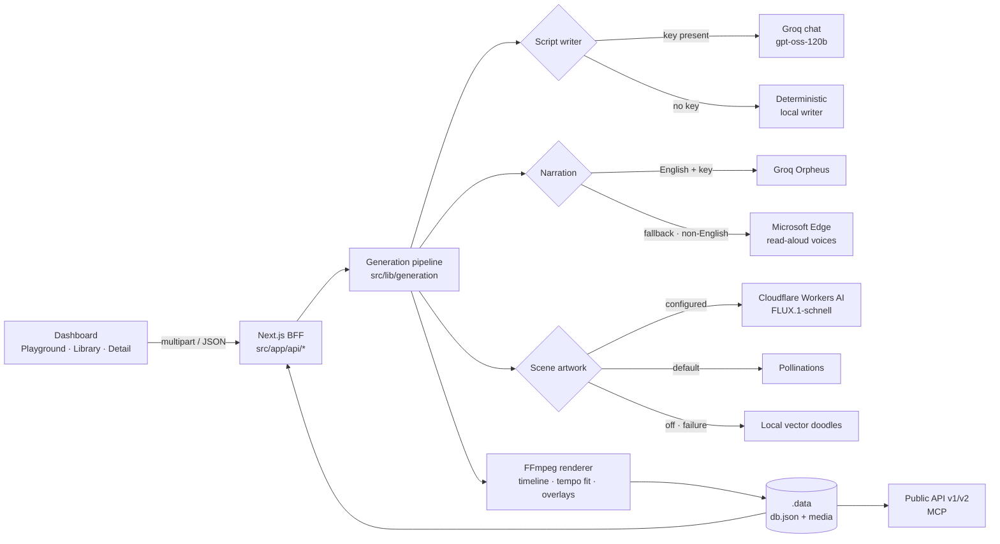

# Golpo Local

**A local-first reconstruction of the Golpo AI video studio — prompt-to-MP4 generation with real narration, AI artwork, presenter overlays, a full BFF, a public REST API and an MCP server.**

[](https://nextjs.org)
[](https://react.dev)
[](https://www.typescriptlang.org)
[](https://nodejs.org)
[](https://ffmpeg.org)

> [!NOTE]
> This is an independent learning reconstruction, not affiliated with Golpo AI.
> The reverse-engineering notes it was built from live in [REPORT.md](REPORT.md);
> the requirement-to-file map lives in [docs/IMPLEMENTATION.md](docs/IMPLEMENTATION.md).

---

## Table of contents

- [Overview](#overview)
- [Highlights](#highlights)
- [Capability matrix](#capability-matrix)
- [Architecture](#architecture)
- [Tech stack](#tech-stack)
- [Quick start](#quick-start)
- [Configuration](#configuration)
- [Usage](#usage)
  - [Dashboard](#dashboard)
  - [Public REST API](#public-rest-api)
  - [MCP server](#mcp-server)
- [Generation pipeline](#generation-pipeline)
- [What each request field changes](#what-each-request-field-changes)
- [Project structure](#project-structure)
- [Scripts](#scripts)
- [Data and reset](#data-and-reset)
- [Deployment](#deployment)
- [Troubleshooting](#troubleshooting)
- [Known limitations](#known-limitations)
- [Contributing](#contributing)
- [Security](#security)
- [License](#license)
- [Acknowledgements](#acknowledgements)

---

## Overview

Golpo Local reproduces the Golpo AI dashboard, its backend-for-frontend contract and its public
surfaces on a single machine at **http://localhost:3000**. It ships with sensible local fallbacks
so it works with **zero configuration**, then upgrades itself to real providers the moment
credentials appear in `.env.local` — no code changes, no rebuild, no vendor lock-in.

The interesting part is not the UI shell: the generation pipeline produces a **real MP4** with
FFmpeg and `sharp`, measuring narration before planning the timeline so the video matches the
requested duration, illustrating scenes with free image-generation providers, and rendering logos,
watermarks, presenter avatars, webcam picture-in-picture, podcast waveforms and music beds.

Everything is optional:

| Capability | Zero-config (no keys) | With credentials |
| --- | --- | --- |
| Script writing | Deterministic local writer | Groq chat completions (`openai/gpt-oss-120b`) |
| Narration | Microsoft Edge read-aloud voices (50+ languages, no key) | Groq Orpheus for English, Edge as fallback |
| Transcription | Disabled | Groq Whisper `whisper-large-v3` |
| Scene artwork | Pollinations (keyless, rate limited) | Cloudflare Workers AI `flux-1-schnell` |
| Rendering | Bundled FFmpeg + `sharp` | Same |
| Authentication | Local HMAC sessions | Supabase email magic link or OAuth |
| Billing | Mock, 999,999 credits | Stripe Checkout + webhooks |

Without `STRIPE_SECRET_KEY` billing stays mocked: every account has **999,999 credits**, every
plan feature is unlocked, and no payment flow can charge anything. With Stripe enabled the ledger
becomes real (plan entitlements, per-generation debits, webhook-driven credit grants).

## Highlights

- **Real videos, not slideshows** — scene frames are rasterised with `sharp` and encoded with the
  bundled FFmpeg binary; posters are JPEG, playback supports HTTP byte ranges.
- **The duration you asked for** — narration is synthesised first, then the timeline is fitted:
  silence tightening → `atempo` pace nudge (0.9–1.25×) → residual spread across scenes. A 20-second
  request ships a ~20-second video even when the model's script or a voice's pacing drifts.
- **Illustrated scenes** — free AI artwork through Cloudflare Workers AI or keyless Pollinations,
  cached per prompt, with local vector doodles as the always-available fallback.
- **17 style palettes, 3 orientations** — every engine/style name is normalised, so `playful`,
  `Playful`, `dry_erase` and `playful_compact` all resolve correctly.
- **Language variants** — generate a video once and receive translated, independently narrated
  and rendered MP4s for each requested variant language.
- **Presenter overlays** — uploaded logos (four placements), watermarks, custom avatars, and
  own-narration webcam clips as picture-in-picture, split screen or fullscreen.
- **Podcasts** — audio-first episodes with waveforms, chapter labels and looping music beds.
- **Full platform surface** — 65+ BFF routes, public API v1 (multipart) and v2 (JSON), MCP tools,
  organizations, playlists, characters, saved styles, voice clones and API keys.

## Capability matrix

| Area | Status |
| --- | --- |
| Google/Microsoft sign-in, sessions, sign-out | Working (local mock, Supabase magic link or OAuth) |
| Playground: prompt, script import, engine/style/language/voice/variants | Working |
| Generation jobs, stage progress, polling, language variants | Working |
| Scripts | Local writer or Groq |
| Transcription | Groq Whisper (word + segment timestamps) or disabled |
| Render | Real MP4 + JPEG poster (FFmpeg), SVG storyboard fallback |
| Scene artwork | Cloudflare, Pollinations or local doodles |
| Library: search, filters, visibility, delete, playlists | Working |
| Characters, saved styles, voice clones, custom music, avatars | Working (stored locally) |
| Organizations, API keys, changelogs, broadcast/status | Working |
| Billing routes (11) + `/api/stripe/webhook` | Mock or Stripe |
| `/api/get-subscription-details`, `/api/active-subscriptions` | 200 locally (production returns 404) |
| Public REST API v1 (multipart) and v2 (JSON) | Working |
| MCP JSON-RPC endpoint with 6 tools | Working |
| PDF/DOCX import | Not implemented (plain text or audio only) |

## Architecture



### Request lifecycle

1. **Normalise** — `src/lib/generation/request.ts` merges multipart fields and the optional
   `request_payload` JSON, then clamps duration (15–900 s), resolves engine, style, languages,
   orientation, overlays and media.
2. **Write** — `script-provider.ts` asks Groq (or the local writer) for a script sized to
   ≈2.3 words/second, retrying up to three times if the draft is short, then trims trailing
   sentences so the story survives.
3. **Narrate** — each scene is synthesised (Orpheus → Edge fallback), silence-tightened and
   measured with `ffprobe`.
4. **Illustrate** — prompts are built per style, artwork is fetched or drawn, and the theme is
   resolved from the style name and orientation.
5. **Render** — scene frames become PNGs, each is encoded with its fitted audio, the segments are
   concatenated, overlays are applied, and the music bed is mixed at a capped duration.
6. **Publish** — the MP4 and poster land in `.data/media`, the job reaches `ready`, and variants
   are queued as their own jobs and videos.

## Tech stack

| Layer | Choice | Why |
| --- | --- | --- |
| Framework | Next.js 15 (App Router) + React 19 | File-based routes for pages and BFF alike |
| Language | TypeScript 5.8 (`strict`) | Contract safety across the request surface |
| Styling | Hand-written CSS | No framework or build step for the UI |
| Storage | Single JSON document with atomic writes | Dependency-free, easy to inspect and reset |
| Video | `ffmpeg-static` + `ffprobe-static` | Reproducible binaries without system installs |
| Images | `sharp` | Fast SVG → PNG and image compositing |
| TTS | Groq Orpheus + `msedge-tts` | Quality English voices plus free multilingual fallback |
| Auth | `@supabase/ssr` (optional) | Magic link and OAuth parity with the original |
| Payments | `stripe` (optional) | Checkout, portal and webhook-driven credits |

## Quick start

### Prerequisites

- **Node.js 20.9+** (developed on Node 26)
- Windows, macOS or Linux — FFmpeg and FFprobe ship as npm binaries
- No database, Docker or external account required

### Install and run

```bash
git clone https://github.com/wordofgodwithai-oss/learning-website-design-with-AI.git
cd learning-website-design-with-AI
npm install
cp .env.example .env.local   # optional; Windows: copy .env.example .env.local
npm run dev
```

Open **http://localhost:3000**.

> [!TIP]
> The app is fully functional with an empty `.env.local`. Adding keys only upgrades individual
> capabilities; nothing is required to generate a video.

### Sign in

1. Click **Continue with Google** or **Continue with Microsoft** on the landing page.
2. The email is pre-filled with `demo@golpo.local`. Either button signs you in immediately — no
   OAuth round-trip and no password.
3. That account is pre-seeded with a welcome video, an organization and a development API key.
4. Any other email creates a fresh local account with infinite credits on the same click.

The session is an HMAC-signed bearer token in an httpOnly `golpo_session` cookie (also accepted as
`Authorization: Bearer …`), so the BFF and the public API behave like the real Supabase-token setup.

### Generate your first video

1. On `/playground`, type a prompt or import a `.txt` / `.md` / `.srt` script.
2. Pick the engine, style, duration, language, voice, variants and watermark.
3. Click **Generate video**. Progress moves through script writing, scene generation, narration,
   visual rendering and encoding.
4. The finished video appears in the Render panel and in `/library`. Open its detail page at
   `/v/{id}` to review the script and variants or download the poster.

## Configuration

Create `.env.local` (gitignored) and restart the dev server after edits. Every value has a working
default, and each integration has an explicit mode so behaviour is predictable.

### Integration modes

| Variable | Values | `auto` resolves to |
| --- | --- | --- |
| `GOLPO_SCRIPT_MODE` | `auto` · `local` · `groq` | `groq` when `GROQ_API_KEY` exists |
| `GOLPO_TTS_MODE` | `auto` · `groq` · `edge` · `none` | `groq` when `GROQ_API_KEY` exists, else `edge` |
| `GOLPO_TRANSCRIBE_MODE` | `auto` · `groq` · `none` | `groq` when `GROQ_API_KEY` exists |
| `GOLPO_IMAGE_MODE` | `auto` · `cloudflare` · `pollinations` · `off` | `cloudflare` when configured, else `pollinations` |
| `GOLPO_RENDER_MODE` | `auto` · `ffmpeg` | `ffmpeg` when the bundled binaries exist |
| `GOLPO_AUTH_MODE` | `auto` · `local` · `supabase` | `supabase` when URL + anon key exist |
| `GOLPO_BILLING_MODE` | `auto` · `mock` · `stripe` | `stripe` when `STRIPE_SECRET_KEY` exists |

### Core

| Variable | Default | Purpose |
| --- | --- | --- |
| `GOLPO_DATA_DIR` | `./.data` | JSON store and uploaded media |
| `GOLPO_SESSION_SECRET` | dev constant | HMAC secret for session tokens |
| `GOLPO_DEV_API_KEY` | `glp_local_dev_key_change_me` | Seeded API key (change before first run) |
| `GOLPO_SIMULATED_RENDER_MS` | `14000` | Minimum simulated progress duration |
| `GOLPO_MAX_CONCURRENT_JOBS` | `5` | Concurrency cap per user |
| `PORT` | `3000` | Next.js port |
| `GOLPO_APP_URL` | `http://localhost:3000` | Redirect base for Stripe |

### Groq — scripts, transcription and narration

| Variable | Default | Purpose |
| --- | --- | --- |
| `GROQ_API_KEY` | — | Enables all Groq-backed features |
| `GROQ_BASE_URL` | `https://api.groq.com/openai/v1` | OpenAI-compatible endpoint |
| `GOLPO_GROQ_MODEL` | `openai/gpt-oss-120b` | Script model |
| `GOLPO_GROQ_TRANSCRIBE_MODEL` | `whisper-large-v3` | Speech-to-text model |
| `GOLPO_GROQ_TTS_MODEL` | `canopylabs/orpheus-v1-english` | Narration model |
| `GOLPO_GROQ_TTS_VOICE` | `hannah` | Default narration voice |
| `GOLPO_GROQ_TIMEOUT_MS` | `45000` | Per-request timeout |

> [!IMPORTANT]
> Orpheus requires a one-time terms acceptance in the Groq console:
> <https://console.groq.com/playground?model=canopylabs%2Forpheus-v1-english>.
> The free tier is limited to 3,600 tokens/day; once exhausted, English narration automatically
> falls back to Edge voices instead of shipping a silent video.

### Scene artwork

| Variable | Default | Purpose |
| --- | --- | --- |
| `CLOUDFLARE_ACCOUNT_ID` | — | Enables Workers AI |
| `CLOUDFLARE_AI_TOKEN` | — | Token with the **Workers AI** permission |
| `GOLPO_CLOUDFLARE_IMAGE_MODEL` | `@cf/black-forest-labs/flux-1-schnell` | Image model |
| `GOLPO_POLLINATIONS_URL` | `https://image.pollinations.ai` | Keyless fallback endpoint |
| `GOLPO_POLLINATIONS_INTERVAL_MS` | `46000` | Per-IP throttle between images |
| `GOLPO_IMAGE_TIMEOUT_MS` | `90000` | Per-image timeout |

Cloudflare Workers AI grants 10,000 free neurons/day (roughly 100 images) with no credit card.
Pollinations needs no account but is rate limited to one image per 45 seconds per IP and adds a
small logo; URLs are cached locally so repeated renders do not re-request them.

### Supabase — authentication

| Variable | Default | Purpose |
| --- | --- | --- |
| `SUPABASE_URL` | — | Project URL |
| `SUPABASE_ANON_KEY` | — | Public anon key |
| `SUPABASE_SERVICE_ROLE_KEY` | — | Optional server-side admin access |

Add `http://localhost:3000/auth/callback*` to the project's redirect allow-list. Email magic links
work with no provider console; Google/Microsoft OAuth can be enabled optionally.

### Stripe — billing

| Variable | Default | Purpose |
| --- | --- | --- |
| `STRIPE_SECRET_KEY` | — | Enables real checkout and the credit ledger |
| `STRIPE_WEBHOOK_SECRET` | — | Verifies `/api/stripe/webhook` |
| `GOLPO_STRIPE_CURRENCY` | `usd` | Checkout currency |
| `GOLPO_UNLIMITED_DEV` | off | Keep unlimited credits while Stripe is configured |

Plans use inline `price_data`, so no dashboard products are required. For webhooks:

```bash
stripe listen --forward-to localhost:3000/api/stripe/webhook
```

### Validating the configuration

```bash
npm run integrations:check            # list what is configured and what is missing
npm run integrations:check -- --strict  # exit non-zero when incomplete
```

`GET /api/health` reports which implementation each capability resolved to (`local`, `groq`,
`supabase`, `stripe`, `ffmpeg`, image provider) without exposing any secret.

## Usage

### Dashboard

| Route | Description |
| --- | --- |
| `/` | Landing page and mock / Supabase sign-in |
| `/playground` | Prompt, script import, render options and live job progress |
| `/library` | Search, filters, visibility, playlists and deletion |
| `/v/{id}` | Shareable detail page with script, variants and poster |
| `/pricing` | Plan catalogue and checkout |
| `/api-docs` | Interactive REST v1/v2 reference |
| `/mcp` | MCP documentation and tool reference |

### Public REST API

Both versions authenticate with the seeded development key, stored only as a SHA-256 hash:

```
x-api-key: glp_local_dev_key_change_me
```

Override it with `GOLPO_DEV_API_KEY` **before first run** — the seed is written on first boot.

**v1 — multipart**

```bash
curl -X POST http://localhost:3000/api/v1/videos/generate \
  -H "x-api-key: glp_local_dev_key_change_me" \
  -F "prompt=Explain how DNS works" \
  -F "durationSeconds=30" \
  -F "language=en"
```

**v2 — JSON**

```bash
curl -X POST http://localhost:3000/api/v2/videos/generate \
  -H "x-api-key: glp_local_dev_key_change_me" \
  -H "content-type: application/json" \
  -d '{
    "prompt": "Why is the sky blue?",
    "golpo_video_engine": "golpo_sketch",
    "sketch_style_variant": "crayon",
    "duration_seconds": 15,
    "narration_language": "en",
    "onscreen_text_language": "English",
    "video_orientation": "9:16",
    "watermark": true
  }'
```

Poll the returned `job_id`:

```bash
curl http://localhost:3000/api/v1/videos/status/{job_id} \
  -H "x-api-key: glp_local_dev_key_change_me"
```

Other endpoints: `GET /api/v1/videos`, `GET /api/v1/videos/{video_id}`,
`POST /api/v1/videos/upload-file`, and the `/api/v2/*` equivalents. The full reference with field
tables is served at `/api-docs`.

### MCP server

Point any MCP client at `http://localhost:3000/api/mcp` with the API key header:

```json
{
  "mcpServers": {
    "golpo-local": {
      "url": "http://localhost:3000/api/mcp",
      "headers": { "x-api-key": "glp_local_dev_key_change_me" }
    }
  }
}
```

Tools: `generate_video`, `upload_file`, `list_videos`, `get_video`, `check_status`, `status`.

## Generation pipeline

`src/lib/generation/pipeline.ts` orchestrates the job and owns the stage/progress contract.

1. **Normalise the request** — duration is clamped to 15–900 s, engines and styles are resolved,
   and languages, variants, media and overlays are typed.
2. **Write the script** — Groq (`openai/gpt-oss-120b` by default) or the deterministic writer.
   Reasoning-style models skip `response_format: json_object` because they reject it. Drafts that
   fall short are retried; drafts that run long lose trailing sentences, never whole scenes.
3. **Synthesise narration** — Orpheus chunks scenes at ~190 characters, concatenates WAV parts,
   and tightens silence; Edge covers other languages and serves as the automatic fallback.
4. **Measure, then fit** — the renderer probes every clip and applies silence tightening, then an
   `atempo` pace change, then spreads any remainder across all scenes. `apad` and an explicit
   `-t` keep the audio and video streams the same length, so music never truncates the picture.
5. **Illustrate** — prompts combine the scene description, style hint and engine (vector for
   canvas, marker line art for sketch), then Cloudflare, Pollinations or the doodle fallback.
6. **Compose frames** — `sharp` rasterises SVG scene frames with the selected theme, orientation
   and layout; logo, watermark, avatar, waveform and caption layers are applied per scene.
7. **Encode and mix** — FFmpeg encodes segments, concatenates them, applies PiP/split/fullscreen
   overlays and mixes a generated or uploaded music bed at the final duration.

If FFmpeg fails, the job falls back to an animated SVG storyboard so generation never hard-fails.

## What each request field changes

| Request field | Effect |
| --- | --- |
| `golpo_video_engine` | Theme, fonts, grain, artwork prompt (canvas vs sketch) |
| `canvas_style_variant` / `image_style` | Palette, accents, artwork style hint |
| `sketch_style_variant` / `pen_style` | Pen look, colour policy, artwork style hint |
| `durationSeconds` / `duration_seconds` | Word budget, pace fitting, final encode length |
| `language` / `narration_language` | Voice selection and narration language |
| `display_language` / `onscreen_text_language` | On-screen labels and captions |
| `variant_languages` | Additional translated and rendered videos |
| `video_orientation` | Canvas size and layout (16:9, 9:16, 1:1) |
| `narration_voice` | Orpheus voice or Edge voice |
| `scene_pacing` | Narration planning speed and scene timing |
| `pen_animation_style` | Stroke reveal behaviour in sketch mode |
| `watermark` / `force_watermark` | Adds the footer watermark |
| `logo_url` + `logo_placement` | Uploaded logo in a chosen corner |
| `avatar_image_url` / `avatar_renderer` | Presenter avatar and rendering mode |
| `own_narration_*` | Webcam clip as PiP, split or fullscreen |
| `background_track` / `custom_music_url` | Generated bed or uploaded music |
| `media_files` / `user_images` / `user_videos` | Reference media and artwork source |
| `visibility` / `is_public` | Library visibility of the resulting video |
| `kind: "podcast"` | Audio-first layout with waveform and chapters |

## Project structure

```
src/
  app/
    page.tsx                 landing page and mock sign-in
    playground/              prompt and render options
    library/                 library feed
    v/[id]/                  shareable video detail
    pricing/                 plan catalogue
    api-docs/                REST reference
    mcp/                     MCP reference
    api/                     65+ BFF, public API and MCP routes
  components/                AppShell, Playground, LibraryClient, auth panels
  lib/
    ai/                      Groq chat/TTS/Whisper and Edge TTS transports
    billing/                 mock and Stripe ledgers, plans, entitlements
    generation/              request normalisation, scripting, pipeline, variants
    media/                   render, audio, artwork, theme, SVG frames, storage
    mcp/                     JSON-RPC server and tools
    supabase/                SSR client, server client, credential checks
    auth.ts, repo.ts, db.ts, storage.ts, integrations.ts, types.ts
docs/IMPLEMENTATION.md       real-vs-simulated map and extension points
REPORT.md                    reverse-engineering notes
scripts/                     smoke test, integration checker, Groq stub
```

## Scripts

| Command | Description |
| --- | --- |
| `npm run dev` | Development server on `:3000` |
| `npm run build` | Production build |
| `npm run start` | Serve the production build |
| `npm run typecheck` | `tsc --noEmit` |
| `npm run smoke` | End-to-end API test (requires the dev server) |
| `npm run integrations:check` | Validate provider configuration without calling providers |
| `npm run mock:groq` | Groq-compatible stub on `:4010` for offline plumbing tests |

`npm run smoke` signs in, calls all startup BFF routes, generates through the browser path, polls
to `ready`, checks variants, MP4 playback (including byte ranges) and the poster, then exercises
API v1, API v2, MCP and the 401 paths. It exits non-zero on failure.

## Data and reset

State lives in `./.data` (gitignored):

- `db.json` — users, credits, videos, jobs, keys, playlists, characters and styles. Written
  atomically behind an in-process mutex.
- `uploads/` — script imports, avatars, logos, music and reference media.
- `media/` — rendered MP4s, posters and cached artwork.

To reset everything, stop the server and delete `.data/`; the next request re-seeds the demo
account.

## Deployment

The app is a standard Next.js application, but the renderer expects a **persistent filesystem** and
native FFmpeg binaries:

```bash
npm run build
npm run start
```

- Mount a persistent volume at `GOLPO_DATA_DIR`; containers with ephemeral disks lose `.data` on
  restart.
- Run on a platform matching the bundled binaries (x64 Linux, macOS or Windows). Serverless
  functions with read-only or ephemeral storage need an external object store for `.data/media`.
- Long renders can exceed serverless request limits — keep generation on a long-running server or
  move the pipeline to a queue worker.
- Set `GOLPO_SESSION_SECRET` and `GOLPO_DEV_API_KEY` to strong values, and put the app behind
  HTTPS before exposing it.
- `GET /api/health` is a suitable readiness probe.

> [!WARNING]
> The seeded development API key is public. Never expose a deployment with the default key or
> mock billing enabled to the internet.

## Troubleshooting

| Symptom | Cause and fix |
| --- | --- |
| `npm` is blocked in PowerShell (`npm.ps1` cannot be loaded) | Call `npm.cmd` directly, e.g. `& "C:\Program Files\nodejs\npm.cmd" run dev` |
| Narration logs `429` and the video is silent | Orpheus daily quota is exhausted and Edge failed. Check network access to Edge TTS, or wait for the quota reset |
| Orpheus returns a terms error | Accept the model terms once in the Groq playground |
| Artwork is missing or slow | Pollinations throttles to one image per 45 s per IP and may return 402; configure Cloudflare or set `GOLPO_IMAGE_MODE=off` |
| Supabase magic link redirects to an error page | Add `http://localhost:3000/auth/callback*` to the redirect allow-list |
| Stripe webhook returns 400 | `STRIPE_WEBHOOK_SECRET` must match the `stripe listen` session |
| Port 3000 is already in use | Set `PORT=3001` (and update `GOLPO_APP_URL`) |
| Videos are shorter or longer than requested | Check the `[render]` logs: they report words/second, pace adjustment and any spread |
| State looks stale or duplicated | Stop the server, delete `.data/`, and restart to re-seed |

## Known limitations

These are deliberate and documented in [docs/IMPLEMENTATION.md](docs/IMPLEMENTATION.md):

1. **Billing defaults to mock.** Without `STRIPE_SECRET_KEY`, credits never decrease, feature gates
   return `true`, and checkout routes answer `{ success: true, mocked: true }`.
2. **Two subscription routes return 200 locally.** Production returns 404 for
   `/api/get-subscription-details` and `/api/active-subscriptions`; returning ledger data keeps the
   console clean.
3. **Rendering is local.** MP4 and poster generation use bundled FFmpeg and `sharp`; the production
   vendor is not observable. The SVG storyboard is only a fallback.
4. **PDF/DOCX import is not implemented.** Plain-text formats and audio transcription only.
5. **Voice catalogues and stock-avatar IDs are local stand-ins.** Real values are not observable
   from the shipped client.
6. **Analytics and ad endpoints acknowledge and do nothing**, so no data leaves the machine unless
   a provider is enabled.
7. **Per-minute credit pricing is inferred.** The real rate is unobservable; the estimate lives in
   `src/lib/billing/shared.ts`.
8. **Single-node storage.** The JSON store is designed for local use, not concurrent multi-instance
   deployments.
9. **No automated test suite beyond the smoke script.** CI would be a welcome contribution.

## Contributing

1. Fork the repository and create a topic branch: `git checkout -b feat/my-change`.
2. Keep the style of the surrounding code and add comments only where the reasoning is non-obvious.
3. Run `npm run typecheck`, then `npm run dev` and `npm run smoke`.
4. Describe the behaviour change and any new environment variables in the pull request.

Bug reports should include the failing route or prompt, the relevant terminal output, and whether
Groq, Supabase or Stripe were enabled.

## Security

- **Never commit `.env.local`.** It is gitignored by default; `.env.example` documents every key.
- Rotate any key that has been pasted into a chat, issue or log.
- The default API key and session secret are development values. Replace both before any shared or
  public deployment.
- All provider access happens in server-only modules (`import "server-only"`), so secrets cannot
  reach the client bundle.
- Analytics, ads and broadcast endpoints are local no-ops; the app does not phone home.

## License

No license file is included yet. This is a personal learning project; add a license (for example,
MIT) before redistributing or accepting outside contributions.

## Acknowledgements

Built on the shoulders of [Next.js](https://nextjs.org), [React](https://react.dev),
[TypeScript](https://www.typescriptlang.org), [FFmpeg](https://ffmpeg.org),
[sharp](https://sharp.pixelplumbing.com), [Groq](https://groq.com),
[Cloudflare Workers AI](https://developers.cloudflare.com/workers-ai/),
[Pollinations](https://pollinations.ai), [Microsoft Edge TTS](https://github.com/rany2/edge-tts),
[Supabase](https://supabase.com) and [Stripe](https://stripe.com).

Golpo AI is a product of its respective owners; this project is an independent reconstruction for
study and local experimentation.
